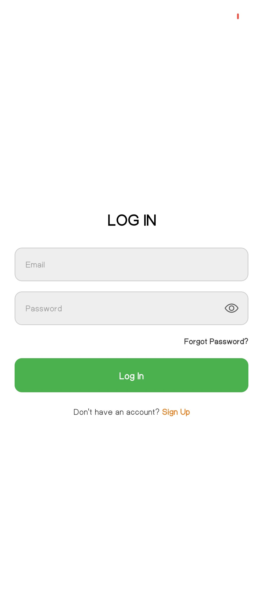
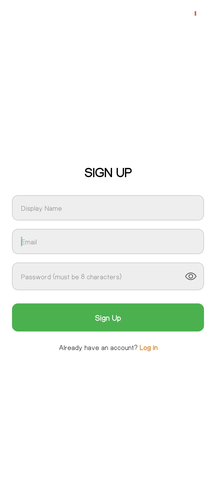
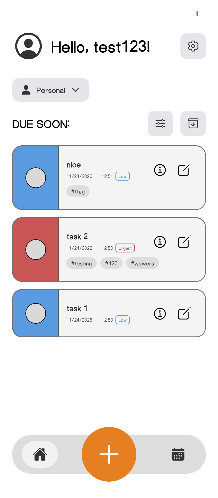
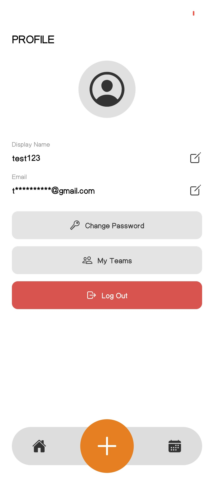
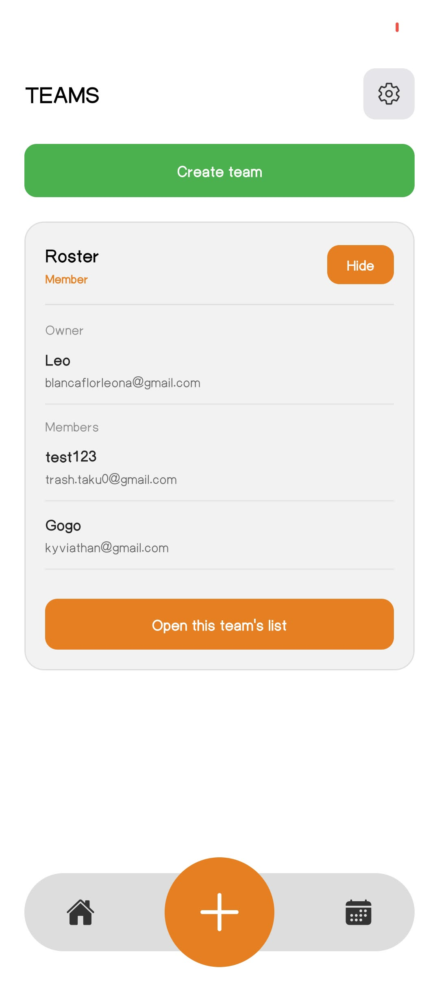
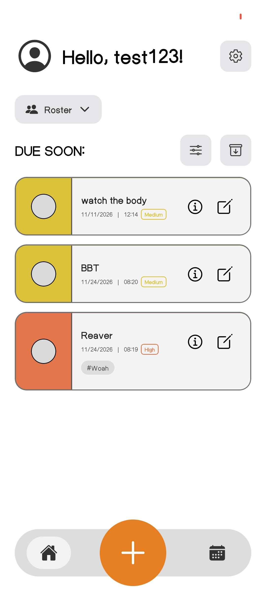
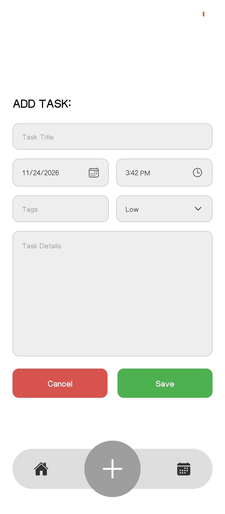
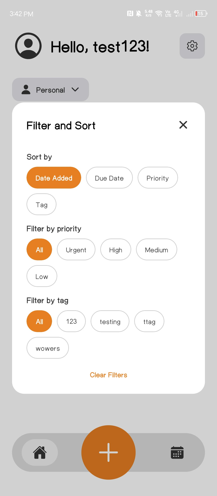
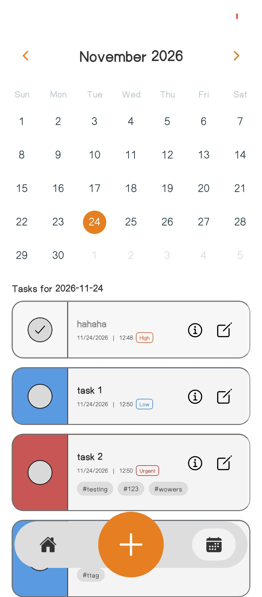
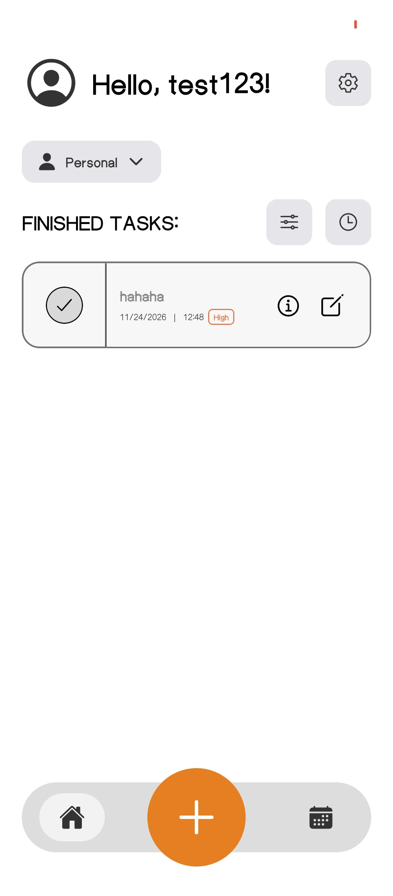

# Task Manager

A cross-platform task management app built for CMSC 128. Users create an account or sign in, then create, view, update, complete, filter, sort, and delete personal tasks or collaborate on tasks in shared teams.

## Tech stack

- **Frontend/UI library:** React Native (React) with Expo SDK 58
- **Navigation:** Expo Router
- **Backend/database:** Firebase client SDK and Cloud Firestore
- **Authentication:** Firebase Authentication with email and password
- **Native session persistence:** Firebase Auth persistence backed by AsyncStorage
- **Programming language:** JavaScript
- **Icons:** Expo Vector Icons (Ionicons)

### Why this stack?

React Native and Expo allow the app to run on Android, iOS, and the web from one codebase. Expo also provides a simple development workflow and built-in support for common React Native features.

Cloud Firestore was chosen because it provides a hosted NoSQL database with a straightforward JavaScript SDK. It works well for task records, supports real-time-ready document operations, and avoids requiring a separate backend server for this project.

Firebase Authentication handles account credentials and auth state. The app uses the Firebase JavaScript SDK directly from the React Native client; it does not expose a custom REST API.

## Activity 1 and Activity 2 integration

Activity 1's `main` branch (`cmsc128-Indiv-Act1-finalX`) provided the task CRUD, filtering, sorting, and calendar foundation. Activity 2 was developed on `act2-accounts` and merged into `act3-ubac` from that Activity 1 history using a pull request and a history-preserving Git merge (`17fb6b3`, PR #7). This kept the Activity 1 commits in the branch history rather than squashing them.

The main overlap was in the task screens and task service. The integration kept the existing task workflows and added Firebase auth state, login/sign-up/profile routes, and per-user task scoping: task creation now stores the current Firebase UID in `userId`, and personal task reads filter by that UID. The merge history does not record a separate conflict-resolution commit; these are the resulting integration changes visible in the merge.

## Features

- Create an account with a display name, email, and password; log in and log out
- Recover a password through a Firebase password-reset email
- Update the profile display name, request an email change with verification, and change the password after reauthentication
- Keep native sign-in state across app launches and route signed-out users to the login screens
- Create tasks with a title, details, due date/time, priority, and tags
- View tasks due today
- View finished tasks
- Mark tasks as complete or incomplete
- Edit task information
- Filter tasks by priority and tags
- Sort tasks by date, priority, or tag
- Delete tasks with a temporary **Undo** action
- View detailed task information
- See task priority in the card's colored side panel and priority label
- View task dates in the calendar
- Create and manage collaborative teams, add members by email, and remove members
- Create and manage tasks in either a personal list or a selected team list

## Refactor and data-access notes

The app has not been benchmarked, so it is not fully performance-optimized. The current structure separates Expo Router screens, shared UI/context, and Firebase operations in `backend/services/`. The Firebase client SDK is used directly; there is no separate HTTP server.

The data model avoids copying user profiles into task documents: tasks store `userId` and optional `teamId`, while teams store `ownerId` and non-owner `memberIds`. Personal task queries are scoped by UID, team queries by team ID, and calendar queries by the visible month. Team lists load owner/member matches in parallel, member documents are fetched in groups, and team-task deletion uses batched writes. These choices reduce repeated reads and keep task records small; they do not replace Firestore Security Rules.

For the current lab-scale use, the implementation is reasonably lightweight; larger task collections may need additional data-loading work:

- The Home screen loads all tasks for the selected personal or team list. Calendar date markers query task records for only the visible month (Firestore still returns each matching document's fields). The Home read may need pagination if task collections grow.
- Completing a task updates the checkbox immediately, saves to Firestore, and keeps the task visible in the active list for 500 ms after a successful save before it moves to Finished. If saving fails, the UI reverts.
- **Edit-task URL injection:** `app/editTask.js` does not read a task ID from the URL. It uses the selected ID from `ListContext`, which the task card sets when the user chooses **Edit**; on web, that selection is also kept in the current tab's `sessionStorage` so a refresh during editing can restore it. A manually added query such as `?taskId=...` is ignored and cannot replace the selected ID. If there is no in-app selection to restore, the edit screen reports that the task is unavailable and returns to Home.

  Ignoring URL parameters is an extra navigation safeguard, not the authorization boundary: `getTaskById` in `backend/services/taskService.js` checks the signed-in user and task ownership/team membership, and `firestore.rules` independently enforces reads and writes at Firestore. Personal tasks are restricted to their creator; team tasks are available only to current team members and owners, with deletion limited to the creator or team owner. The rules must be deployed to the Firebase project for those server-side checks to protect live data.
- Firestore composite indexes are versioned in `firestore.indexes.json`: `tasks(teamId, userId, dueDate)` supports personal date queries (`teamId == null`), and `tasks(teamId, dueDate)` supports team date queries. The older `tasks(userId, dueDate)` index is omitted because current personal queries also filter by `teamId`. Security Rules are versioned in `firestore.rules`; both files are deployed with the Firebase CLI. Client-side checks are not a security boundary. If another query needs an index, add Firestore's suggested definition to `firestore.indexes.json` and wait for it to finish building.

## Prerequisites

Install the following before running the project:

- Node.js and npm
- Expo-compatible device or emulator, or a web browser
- A Firebase project with Email/Password Authentication and Cloud Firestore enabled

## Local setup

1. Clone the repository and enter the project folder:

   ```bash
   git clone https://github.com/leoleom/cmsc128-Lab1_CRUD_blancaflor.git
   cd cmsc128-Lab1_CRUD_blancaflor
   ```

2. Install dependencies:

   ```bash
   npm install
   ```

3. Copy `.env_EXAMPLE` to `.env` in the project root and fill in the Firebase web app configuration:

   ```env
   EXPO_PUBLIC_FIREBASE_API_KEY=your_api_key
   EXPO_PUBLIC_FIREBASE_AUTH_DOMAIN=your_project.firebaseapp.com
   EXPO_PUBLIC_FIREBASE_PROJECT_ID=your_project_id
   EXPO_PUBLIC_FIREBASE_STORAGE_BUCKET=your_project.firebasestorage.app
   EXPO_PUBLIC_FIREBASE_MESSAGING_SENDER_ID=your_sender_id
   EXPO_PUBLIC_FIREBASE_APP_ID=your_app_id
   ```

4. In the Firebase console, enable **Authentication > Sign-in method > Email/Password** and create a **Cloud Firestore** database. The app creates documents in the `users`, `tasks`, and `teams` collections as users sign up and use the app.

5. Review the checked-in `firestore.rules`. Team owners are stored in `ownerId`; `memberIds` contains only non-owner members. Team tasks are readable and editable only by current team owners/members. Deletion is additionally limited to the task creator or team owner. Removing a member revokes their access even to tasks they created. Personal tasks remain owner-scoped, and updates cannot change `userId` or `teamId`.

   Sign in to Firebase CLI and deploy the checked-in rules and indexes to the intended project:

   ```bash
   npx --yes firebase-tools@latest login
   npx --yes firebase-tools@latest deploy --only firestore --project YOUR_FIREBASE_PROJECT_ID
   ```

   Deployment changes the live project's access policy and index configuration. Verify the project ID and compare `firestore.indexes.json` with any other indexes the live project still needs before deploying. Test the rules before deployment. The app's invitation/member-name lookup uses the `users` collection, and the checked-in rules allow any signed-in user to read that collection; this exposes stored emails and display names to all signed-in users.


## Run the app

Start the Expo development server from the project root:

```bash
npx expo start
```

Then press `w` for web, `a` for Android, or `i` for iOS in the Expo terminal. You can also start a target directly:

```bash
npx expo start --web
npx expo start --android
npx expo start --ios
```

For Android or iOS, the corresponding emulator or development device must be available.

## Android APK deployment with Expo EAS

The Android application ID is `com.rykonnen.Todone`. The `preview` profile in `eas.json` is configured to create an internally distributed APK that can be installed directly on an Android device.

EAS Build runs on Expo's servers and uploads a copy of the project source. Use it only if you are comfortable with that upload. The local `.env` file is gitignored and is not included in the EAS build archive; configure the Firebase values in your Expo project's **Environment variables** page for the `preview` environment. Add these six names with the matching values from your Firebase web app configuration:

```text
EXPO_PUBLIC_FIREBASE_API_KEY
EXPO_PUBLIC_FIREBASE_AUTH_DOMAIN
EXPO_PUBLIC_FIREBASE_PROJECT_ID
EXPO_PUBLIC_FIREBASE_STORAGE_BUCKET
EXPO_PUBLIC_FIREBASE_MESSAGING_SENDER_ID
EXPO_PUBLIC_FIREBASE_APP_ID
```

These `EXPO_PUBLIC_` values are included in the client app bundle; they are configuration, not server-side secrets. Use Expo's **Sensitive** visibility to hide values from logs. Do not put passwords, service-account keys, or other server secrets in client environment variables.

From the project root:

1. Sign in to your Expo account and connect this app to an EAS project:

   ```bash
   npx eas-cli@latest build:configure
   ```

   Follow the prompts to create or link the EAS project.

2. After setting the `preview` environment variables, start the cloud APK build:

   ```bash
   npx eas-cli@latest build --platform android --profile preview
   ```

3. When the build completes, open its Expo build page, download the APK, and transfer it to the tablet. Android may ask you to allow installation from the browser or file app used to open it.

The current Android build is available in this [Google Drive folder](https://drive.google.com/drive/folders/1n36tyOawBMwVpihdMDn-rs7Q5STO72R0?usp=sharing). Confirm the instructor has access to the folder. Install and test the APK on a second Android device before the defense. Deploy Firestore rules separately and only after reviewing their effect on the live Firebase project.

## Authentication and sessions

Authentication is provided by Firebase Authentication's email/password provider. Sign-up creates a Firebase user and sets the user's display name. The app requires passwords to be at least 8 characters at sign-up and when changing a password in Profile; configure Firebase Authentication's password policy to enforce the same minimum for password-reset flows. Login signs in with the email and password. The app listens for Firebase auth-state changes in `AuthContext`; the root layout waits for the initial auth check and then redirects signed-out users to `/login` and signed-in users away from the public login, sign-up, and password-reset screens.

On native platforms, Firebase Auth persistence is initialized with React Native AsyncStorage, so the Firebase session can be restored after restarting the app. On web, the app uses Firebase's standard web Auth initialization. Logging out calls Firebase `signOut` and ends the current session.

Password recovery is email-based: the user enters their email on **Forgot Password**, and Firebase sends a password-reset link using `sendPasswordResetEmail`. The app does not store or handle password-reset tokens itself. The profile screen also supports changing a password after reauthentication with the current password, and requesting an email change after reauthentication; Firebase sends a verification link, and the email is not changed until it is confirmed.

The authentication service in [`backend/services/authService.js`](./backend/services/authService.js) exposes these equivalent operations (there are no HTTP endpoints):

```js
await registerUser({ email, password, displayName });
await loginUser({ email, password });
await requestPasswordReset(email);
await changeUserPassword({ currentPassword, newPassword });
await requestEmailChange({ currentPassword, newEmail });
await logoutUser();
```

## Firestore data model

The app uses three top-level Firestore collections. Firebase Authentication is the source of user identity; each user's document ID is their Firebase UID.

- `users/{uid}` stores the account's lowercase email and optional display name. It is synced from the authenticated Firebase user.
- `teams/{teamId}` stores a shared list, its owner, and its members:

  ```js
  {
    name: "Project team",
    ownerId: "firebase-auth-uid",
    memberIds: ["another-auth-uid"],
    createdAt: Timestamp
  }
  ```

  `memberIds` contains only non-owner members. The owner is identified separately by `ownerId` and receives team access through that field.

- `tasks/{taskId}` stores each task. A personal task has `teamId: null`; a shared task has the ID of its team. `userId` identifies the task creator in either case.

  ```js
  {
    userId: "firebase-auth-uid",
    teamId: null, // or a team document ID for a shared task
    title: "Submit lab report",
    details: "Finish the CRUD documentation",
    dueDate: Timestamp,
    priority: "high",
    tags: ["school", "cmsc128"],
    isDone: false,
    createdAt: Timestamp
  }
  ```

Tasks are not nested under users or teams; `userId` and `teamId` link each task to its creator and, optionally, its shared list. Deleting a team also deletes its associated tasks.

## Operations and ownership checks

The app accesses Firebase directly through the client SDK rather than a custom HTTP API. It does not expose REST endpoint URLs; the examples below show database operations provided by functions in [`backend/services/taskService.js`](./backend/services/taskService.js) and [`backend/services/teamService.js`](./backend/services/teamService.js).

```js
// Personal task: createTask reads auth.currentUser.uid and stores it as userId.
await createTask({ title, details, dueDate, priority, tags });

// Personal task reads are filtered by the signed-in user's UID.
const personalTasks = await getAllTasks();

// A single-task read returns null unless the current user owns the personal
// task or is a member of the team associated with the shared task.
const task = await getTaskById(taskId);

// Team administration checks the signed-in UID against teams/{teamId}.ownerId.
await addMemberByEmail(teamId, email);
await deleteTeam(teamId);
```

For a personal task, `getTaskById` checks `task.userId` against the current UID. For a team task, it checks that the team exists and that the UID appears in `team.memberIds` or matches `ownerId`. `getMyTeams` queries both fields and merges the results. Team member addition and team deletion check `ownerId`. Task list queries are scoped by user ID for personal tasks or by team ID for shared tasks. Firestore Rules repeat these access checks on the server; a former team member loses access to shared tasks even if they originally created them.

The client applies ownership checks for clearer application behavior; the rules in `firestore.rules` enforce access at Firestore after they are deployed. Updating this file does not change the live Firebase project until an authorized deploy is run.

## Task CRUD

### Create

`createTask(taskData)` adds a document to `tasks`. Omitting `teamId` creates a personal task; supplying a selected team ID creates a shared task:

```js
await createTask({
  title,
  details,
  dueDate,
  priority,
  tags,
  teamId, // optional; null for a personal task
});
```

### Read

Read one task by document ID or fetch tasks from the active personal/team list:

```js
const task = await getTaskById(taskId);
const tasks = await getAllTasks(teamId); // omit/null for personal tasks
```

Read tasks due on a specific date:

```js
const tasksForDate = await getTasksByDate("2026-09-09", teamId);
```

### Update

Update task fields:

```js
await updateTask(taskId, {
  title,
  details,
  dueDate,
  priority,
  tags,
});
```

Toggle completion:

```js
await toggleTaskComplete(taskId, currentIsDone);
```

### Delete

Permanent deletion uses:

```js
await deleteTask(taskId);
```

The edit screen first returns to the task list and displays an Undo snackbar. If the user does not undo within five seconds, the delete operation is finalized.

## Screenshots

### Login


### Sign Up


### Home Task List


### Profile


### Teams


### Team Task List


### Add Task


### Filter and Sort


### Calendar


### Finished Tasks

