# Task Manager

A cross-platform task management app built for CMSC 128. Users create an account or sign in, then create, view, update, complete, filter, sort, and delete personal tasks or collaborate on tasks in shared teams.

## Tech stack

- **Frontend/UI library:** React Native (React) with Expo SDK 57
- **Navigation:** Expo Router
- **Backend/database:** Firebase client SDK and Cloud Firestore
- **Authentication:** Firebase Authentication with email and password
- **Native session persistence:** Firebase Auth persistence backed by AsyncStorage
- **Programming language:** JavaScript
- **Icons:** Expo Vector Icons (Ionicons)

### Why this stack?

React Native and Expo allow the app to run on Android, iOS, and the web from one codebase. Expo also provides a simple development workflow and built-in support for common React Native features.

Cloud Firestore was chosen because it provides a hosted NoSQL database with a straightforward JavaScript SDK. It works well for task records, supports real-time-ready document operations, and avoids requiring a separate backend server for this project.

Firebase Authentication handles account credentials and auth state. The app uses the Firebase JavaScript SDK directly from the React Native client; it does not expose a custom REST API.

## Activity 1 and Activity 2 integration

Activity 1's `main` branch (`cmsc128-Indiv-Act1-finalX`) provided the task CRUD, filtering, sorting, and calendar foundation. Activity 2 was developed on `act2-accounts` and merged into `act3-ubac` from that Activity 1 history using a pull request and a history-preserving Git merge (`17fb6b3`, PR #7). This kept the Activity 1 commits in the branch history rather than squashing them.

The main overlap was in the task screens and task service. The integration kept the existing task workflows and added Firebase auth state, login/sign-up/profile routes, and per-user task scoping: task creation now stores the current Firebase UID in `userId`, and personal task reads filter by that UID. The merge history does not record a separate conflict-resolution commit; these are the resulting integration changes visible in the merge.

## Features

- Create an account with a display name, email, and password; log in and log out
- Recover a password through a Firebase password-reset email
- Update the profile display name, request an email change with verification, and change the password after reauthentication
- Keep native sign-in state across app launches and route signed-out users to the login screens
- Create tasks with a title, details, due date/time, priority, and tags
- View tasks due today
- View finished tasks
- Mark tasks as complete or incomplete
- Edit task information
- Filter tasks by priority and tags
- Sort tasks by date, priority, or tag
- Delete tasks with a temporary **Undo** action
- View detailed task information
- View task dates in the calendar
- Create and manage collaborative teams, add members by email, and remove members
- Create and manage tasks in either a personal list or a selected team list

## Prerequisites

Install the following before running the project:

- Node.js and npm
- Expo-compatible device or emulator, or a web browser
- A Firebase project with Email/Password Authentication and Cloud Firestore enabled

## Local setup

1. Clone the repository and enter the project folder:

   ```bash
   git clone https://github.com/leoleom/cmsc128-Lab1_CRUD_blancaflor.git
   cd cmsc128-Lab1_CRUD_blancaflor
   ```

2. Install dependencies:

   ```bash
   npm install
   ```

3. Copy `.env_EXAMPLE` to `.env` in the project root and fill in the Firebase web app configuration:

   ```env
   EXPO_PUBLIC_FIREBASE_API_KEY=your_api_key
   EXPO_PUBLIC_FIREBASE_AUTH_DOMAIN=your_project.firebaseapp.com
   EXPO_PUBLIC_FIREBASE_PROJECT_ID=your_project_id
   EXPO_PUBLIC_FIREBASE_STORAGE_BUCKET=your_project.firebasestorage.app
   EXPO_PUBLIC_FIREBASE_MESSAGING_SENDER_ID=your_sender_id
   EXPO_PUBLIC_FIREBASE_APP_ID=your_app_id
   ```

4. In the Firebase console, enable **Authentication > Sign-in method > Email/Password** and create a **Cloud Firestore** database. The app creates documents in the `users`, `tasks`, and `teams` collections as users sign up and use the app; no seed data or database migration is required.

5. Configure and deploy Firestore Security Rules before using real user data. Rules should restrict personal task access to its `userId` owner and shared task/team access to team members, and restrict team administration to the team owner as appropriate. This repository does not include deployable Firestore rules: client-side ownership checks and query filters are useful application behavior, but are not a security boundary.

## Run the app

Start the Expo development server from the project root:

```bash
npx expo start
```

Then press `w` for web, `a` for Android, or `i` for iOS in the Expo terminal. You can also start a target directly:

```bash
npx expo start --web
npx expo start --android
npx expo start --ios
```

For Android or iOS, the corresponding emulator or development device must be available.

## Authentication and sessions

Authentication is provided by Firebase Authentication's email/password provider. Sign-up creates a Firebase user and sets the user's display name. Login signs in with the email and password. The app listens for Firebase auth-state changes in `AuthContext`; the root layout waits for the initial auth check and then redirects signed-out users to `/login` and signed-in users away from the public login, sign-up, and password-reset screens.

On native platforms, Firebase Auth persistence is initialized with React Native AsyncStorage, so the Firebase session can be restored after restarting the app. On web, the app uses Firebase's standard web Auth initialization. Logging out calls Firebase `signOut` and ends the current session.

Password recovery is email-based: the user enters their email on **Forgot Password**, and Firebase sends a password-reset link using `sendPasswordResetEmail`. The app does not store or handle password-reset tokens itself. The profile screen also supports changing a password after reauthentication with the current password, and requesting an email change after reauthentication; Firebase sends a verification link, and the email is not changed until it is confirmed.

The authentication service in [`backend/services/authService.js`](./backend/services/authService.js) exposes these equivalent operations (there are no HTTP endpoints):

```js
await registerUser({ email, password, displayName });
await loginUser({ email, password });
await requestPasswordReset(email);
await changeUserPassword({ currentPassword, newPassword });
await requestEmailChange({ currentPassword, newEmail });
await logoutUser();
```

## Firestore data model

The app uses three top-level Firestore collections. Firebase Authentication is the source of user identity; each user's document ID is their Firebase UID.

- `users/{uid}` stores the account's lowercase email and optional display name. It is synced from the authenticated Firebase user.
- `teams/{teamId}` stores a shared list, its owner, and its members:

  ```js
  {
    name: "Project team",
    ownerId: "firebase-auth-uid",
    memberIds: ["firebase-auth-uid", "another-auth-uid"],
    createdAt: Timestamp
  }
  ```

- `tasks/{taskId}` stores each task. A personal task has `teamId: null`; a shared task has the ID of its team. `userId` identifies the task creator in either case.

  ```js
  {
    userId: "firebase-auth-uid",
    teamId: null, // or a team document ID for a shared task
    title: "Submit lab report",
    details: "Finish the CRUD documentation",
    dueDate: Timestamp,
    priority: "high",
    tags: ["school", "cmsc128"],
    isDone: false,
    createdAt: Timestamp
  }
  ```

Tasks are not nested under users or teams; `userId` and `teamId` link each task to its creator and, optionally, its shared list. Deleting a team also deletes its associated tasks.

## Operations and ownership checks

The app uses Firebase client operations rather than a custom HTTP API. The examples below are functions from [`backend/services/taskService.js`](./backend/services/taskService.js) and [`backend/services/teamService.js`](./backend/services/teamService.js):

```js
// Personal task: createTask reads auth.currentUser.uid and stores it as userId.
await createTask({ title, details, dueDate, priority, tags });

// Personal task reads are filtered by the signed-in user's UID.
const personalTasks = await getAllTasks();

// A single-task read returns null unless the current user owns the personal
// task or is a member of the team associated with the shared task.
const task = await getTaskById(taskId);

// Team administration checks the signed-in UID against teams/{teamId}.ownerId.
await addMemberByEmail(teamId, email);
await deleteTeam(teamId);
```

For a personal task, `getTaskById` checks `task.userId` against the current UID. For a team task, it checks that the team exists and that the UID appears in `team.memberIds`. Team member addition and team deletion check `ownerId`. Task list queries are scoped by user ID for personal tasks or by team ID for shared tasks.

These checks run in the client and do not replace Firestore Security Rules. In particular, task update/delete functions issue Firestore writes by document ID; the deployed rules must authorize those writes (and team membership/owner access) using the authenticated user and stored document data.

## Task CRUD

### Create

`createTask(taskData)` adds a document to `tasks`. Omitting `teamId` creates a personal task; supplying a selected team ID creates a shared task:

```js
await createTask({
  title,
  details,
  dueDate,
  priority,
  tags,
  teamId, // optional; null for a personal task
});
```

### Read

Read one task by document ID or fetch tasks from the active personal/team list:

```js
const task = await getTaskById(taskId);
const tasks = await getAllTasks(teamId); // omit/null for personal tasks
```

Read tasks due on a specific date:

```js
const tasksForDate = await getTasksByDate("2026-09-09", teamId);
```

### Update

Update task fields:

```js
await updateTask(taskId, {
  title,
  details,
  dueDate,
  priority,
  tags,
});
```

Toggle completion:

```js
await toggleTaskComplete(taskId, currentIsDone);
```

### Delete

Permanent deletion uses:

```js
await deleteTask(taskId);
```

The edit screen first returns to the task list and displays an Undo snackbar. If the user does not undo within five seconds, the delete operation is finalized.

## Screenshots

#### Login Screen

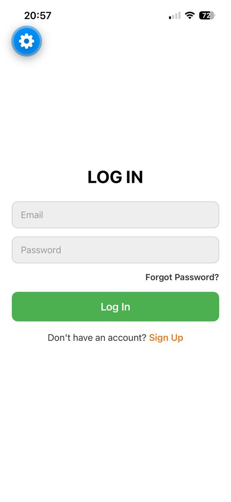

#### Sign Up Screen

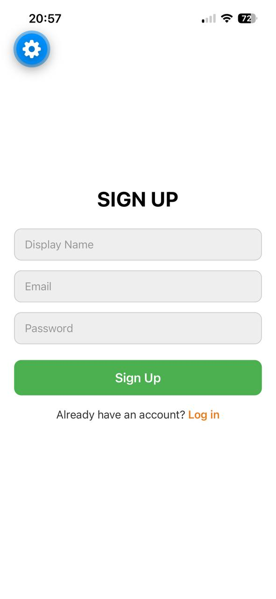

#### Forgot Password Screen

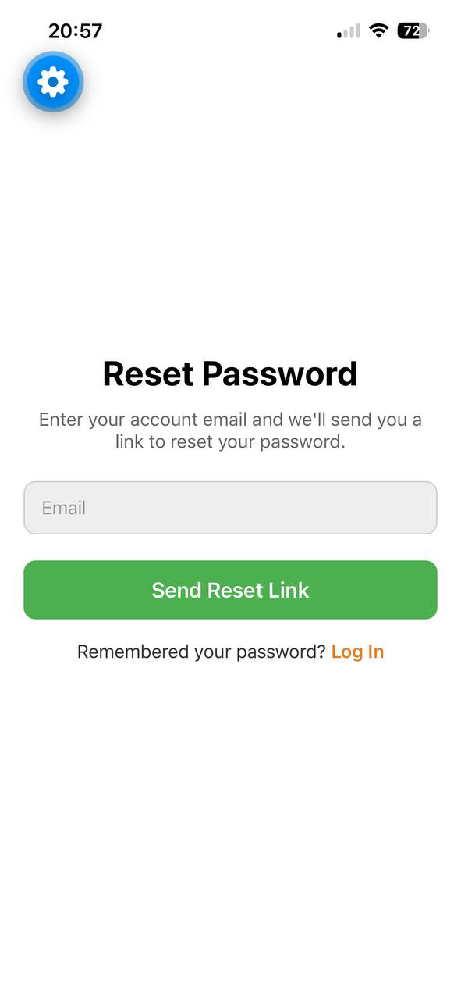

#### Home Screen

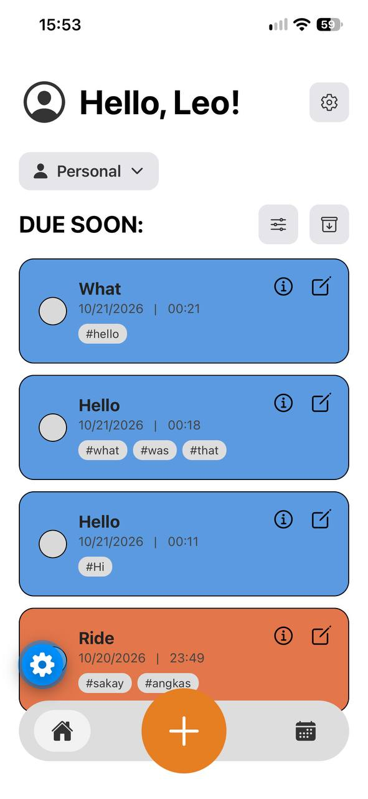

#### Profile Screen
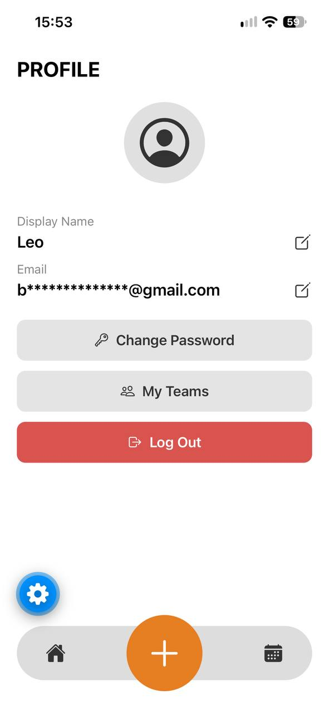

### Teams Screen
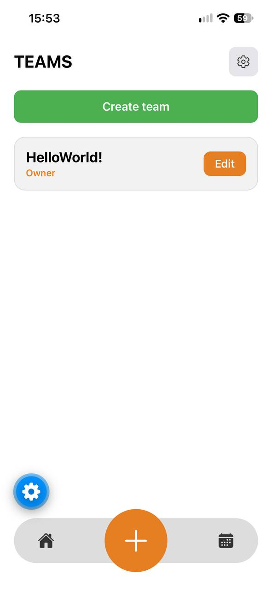


#### Add Task Screen
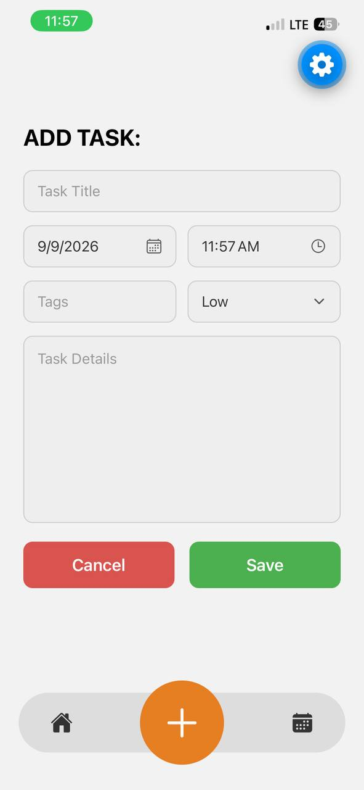

#### Edit Task Screen

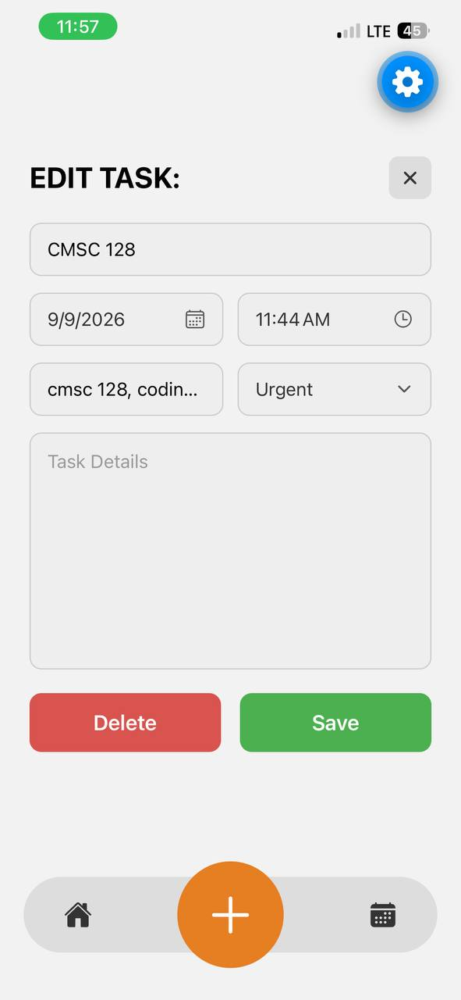

### Switch Team Screen
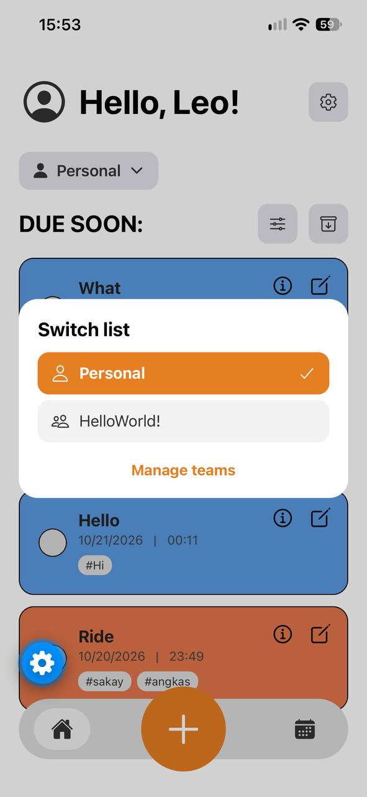

### Filter and Sort Controls

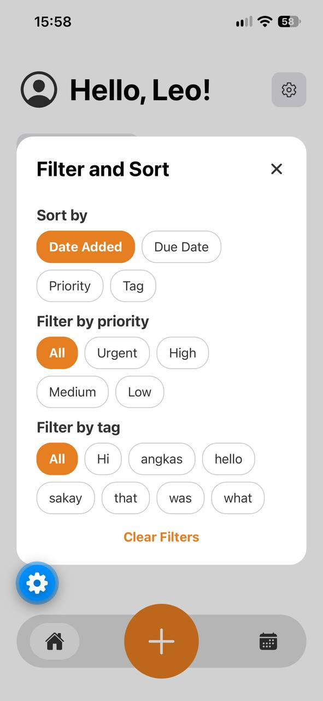

### Calendar

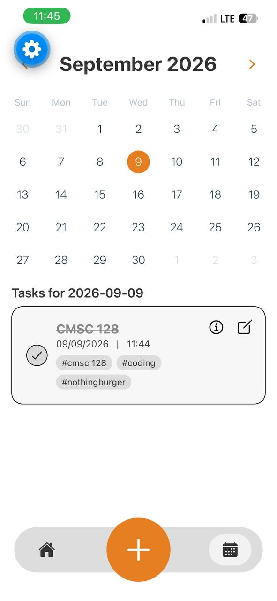

### Task Details

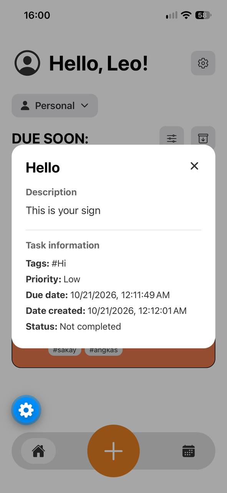

### Finished Tasks

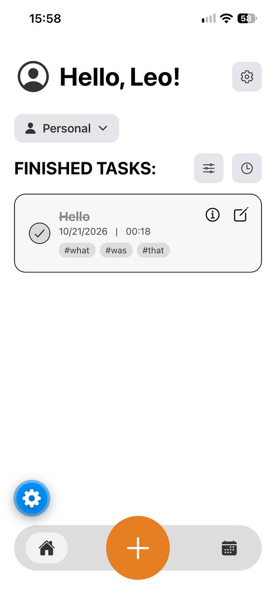
